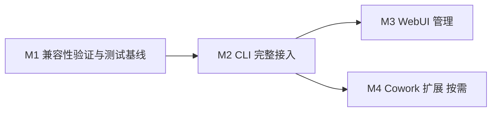

# Claude Desktop 实施计划

本计划将 [Claude Desktop 支持方案](claude-desktop-plan.md) 拆为可依次合并的 PR。M1、M2、M3 为首期必交 Milestone；M4 根据 Cowork 验证结果决定是否需要独立 PR。每个 Milestone 包含实现、测试、使用说明和验收证据，合并后不依赖后续 PR 修复基本行为。

当前状态为计划待实施。CD 编号为计划编号，实际任务通过下表对应的 GitHub Issue 跟踪。首期平台为 macOS，继续使用 schema 3、四档模型和锁定 SDK。

## GitHub 跟踪

[GitHub Project](https://github.com/users/shichao-wang/projects/6) 汇总进度，[总 Issue #17](https://github.com/shichao-wang/cpa/issues/17) 通过原生子 Issue 关系跟踪全部任务。任务间使用原生 blocked-by 依赖，Milestone 使用仓库原生字段。

| Milestone | 子任务 Issue |
| --- | --- |
| [Claude Desktop M1 兼容性验证与测试基线](https://github.com/shichao-wang/cpa/milestone/1) | [CD-01 #18](https://github.com/shichao-wang/cpa/issues/18)、[CD-02 #19](https://github.com/shichao-wang/cpa/issues/19)、[CD-03 #20](https://github.com/shichao-wang/cpa/issues/20)、[CD-04 #21](https://github.com/shichao-wang/cpa/issues/21) |
| [Claude Desktop M2 CLI 完整接入](https://github.com/shichao-wang/cpa/milestone/2) | [CD-05 #22](https://github.com/shichao-wang/cpa/issues/22)、[CD-06 #23](https://github.com/shichao-wang/cpa/issues/23)、[CD-07 #24](https://github.com/shichao-wang/cpa/issues/24)、[CD-08 #25](https://github.com/shichao-wang/cpa/issues/25)、[CD-09 #26](https://github.com/shichao-wang/cpa/issues/26) |
| [Claude Desktop M3 WebUI 管理](https://github.com/shichao-wang/cpa/milestone/3) | [CD-10 #27](https://github.com/shichao-wang/cpa/issues/27)、[CD-11 #28](https://github.com/shichao-wang/cpa/issues/28)、[CD-12 #29](https://github.com/shichao-wang/cpa/issues/29) |
| [Claude Desktop M4 Cowork 扩展](https://github.com/shichao-wang/cpa/milestone/4) | [CD-13 #30](https://github.com/shichao-wang/cpa/issues/30)、[CD-14 #31](https://github.com/shichao-wang/cpa/issues/31)、[CD-15 #32](https://github.com/shichao-wang/cpa/issues/32)、[CD-16 #33](https://github.com/shichao-wang/cpa/issues/33) |

每个实施 PR 归属对应 Milestone，并用 `Closes #编号` 关联实际完成的子 Issue。PR 合并且满足验收后关闭 Milestone。计划文档 PR 只关联总 Issue，不关闭实现任务，也不占用 M1 的交付 PR。M4 无需独立实施时，记录依据并将相应任务以不计划关闭，避免创建空 PR。

## Milestone 与依赖

| Milestone | 建议 PR 标题 | 可独立交付的结果 | 前置依赖 |
| --- | --- | --- | --- |
| M1 | 验证 Claude Desktop 网关接入并建立隔离测试基线 | 可复跑的本地 mock、脱敏配置样本、兼容性结论及手动验证步骤 | 无 |
| M2 | 支持通过 CLI 安全接管和恢复 Claude Desktop 配置 | 创建 Desktop profile，完成 apply、切换、restore 和异常恢复 | M1 的配置契约及 Chat、本地 Code 验证通过 |
| M3 | 在 WebUI 中管理 Claude Desktop profile | 页面创建、编辑、识别受管状态，并提供本机配置指引 | M2 |
| M4 | 补齐 Claude Desktop Cowork 兼容性 | 完成尚未覆盖的 Cowork 请求、工具与会话生命周期支持 | M2，且 M1 或 M2 发现需要独立处理的 Cowork 差异 |



M2 合并后即可通过 CLI 使用首期功能，M3 不作为 CLI 发布的前提。M3 与 M4 可以同期开发，合并时分别以已经通过检查的主分支为基础。M4 不阻塞 Chat 和本地 Code 的交付。

## M1 兼容性验证与测试基线

本 PR 消除配置格式和本地网络路径的不确定性，交付测试工具与证据。生产环境的 agent 校验和 apply/restore 行为保持现状。

| 子任务 | 内容与交付物 | 依赖 |
| --- | --- | --- |
| CD-01 | 建立独立 macOS 测试用户或 VM，启动临时 cpa 与本地 mock；记录隔离方式、应用版本和清理步骤 | 无 |
| CD-02 | 用官方配置窗口生成、切换和取消配置，整理 `<id>.json`、`_meta.json` 及必要模式文件的脱敏样本 | CD-01 |
| CD-03 | 以手动配置驱动真实 Desktop，验证 Chat、本地 Code 和 Cowork 的 loopback、路径、鉴权、模型 ID、流式文本及最小工具往返 | CD-01、CD-02 |
| CD-04 | 整理可复跑脚本、结果断言和兼容性报告，确定配置识别规则、已验证版本及 M4 是否需要独立交付 | CD-02、CD-03 |

主要涉及 `scripts/compat/`、测试 fixture 和 `docs/`。手动实验使用临时 profile 与专用端口，不调用生产 apply 接管日常 Desktop。可复用现有协议 mock，但 Desktop 的隔离方式必须单独验证，不能直接假定临时 HOME 足够。

完成条件：

- 测试能区分成功、失败、未执行，并验证预期回复与真实出站请求。证据不包含 key、token、账户信息或日常会话内容。
- 明确 Desktop 实际读取的配置来源、活动项格式、完整重启要求，以及是否接受当前 loopback HTTP 地址。
- Chat 文本和本地 Code 的工具往返通过，所有模型请求均落在临时网关和 mock。Cowork 单独记录结果。
- 脱敏样本足以支持后续解析与事务测试；清理后临时网关停止，日常客户端配置保持原样。

如果配置契约或 Chat、本地 Code 验证未通过，M1 可以作为调查结论和诊断工具 PR 合并，但不开放 M2 实施。应先更新方案，解决具体阻塞项。Cowork 单独失败不阻塞 M2。

## M2 CLI 完整接入

本 PR 将 Desktop 作为可用的下游 Agent 交付。新增 agent 合法值、CLI 分派和配置管理必须一起上线，避免出现 Desktop profile 被 Claude Code 适配器误处理的中间版本。

| 子任务 | 内容与交付物 | 依赖 |
| --- | --- | --- |
| CD-05 | 统一 agent 校验，增加 `claude-desktop`；建立按 profile ID 查询各适配器受管引用的入口，明确锁顺序及 agent 切换规则 | CD-04 通过 |
| CD-06 | 新增 Desktop 适配器，根据已验证样本检查本地配置、识别策略覆盖，并从当前 profile 派生网关参数与四档模型列表 | CD-05 |
| CD-07 | 实现完整 apply/restore、首次基线保留、跨文件 pending 记录、回读校验和中断恢复；处理外部编辑与受管冲突 | CD-06 |
| CD-08 | 将 create、apply、restore 接入 CLI；同步接入 CLI 与管理 API 的删除保护、agent 更新保护和受管状态，补充参数及错误说明 | CD-05、CD-07 |
| CD-09 | 用自动接管后的真实 Desktop 重跑 M1 基线，补齐事务与并发测试、命令示例、回退说明及兼容性报告 | CD-03、CD-08 |

CD-05 至 CD-08 可以拆为同一 PR 内的提交，不能分别合并为缺少恢复或引用保护的生产版本。管理 API 的正确性在 M2 完成，M3 只增加页面交互。

主要涉及 `internal/config/`、`internal/profile/`、新增的 `internal/agent/claudedesktop/`、`internal/cli/`、`internal/webui/handler.go`、相关测试和 README。仅增加必要的 agent 分派与引用查询，保留 Claude Code 现有事务实现。

完成条件：

- CLI 可创建 Desktop profile 并完成 apply、重复 apply、profile 切换和 restore。`restore` 默认仍处理 Claude Code，Desktop 显式指定 `--agent claude-desktop`；`--settings` 与 `--config-dir` 不可用错适配器。
- Claude Code 与 Desktop 可同时受管。任一适配器的 committed 或 pending 记录都会阻止对应 profile 被删除或切换 agent；CLI 和管理 API 执行相同规则。
- 对每个跨文件写入点注入中断后，下一次操作可安全恢复。受管冲突、损坏 JSON、符号链接、配置来源不明和组织推理策略覆盖均拒绝写入，无关编辑保留。
- 真实 Desktop 加本地 mock 的 Chat 和本地 Code 验收通过；OAuth 失效及在途输出撤销规则保持有效，且配置和日志不包含上游凭证。

本 PR 的发布说明只列已通过验证的界面与版本。应用配置后提示完整重新打开 Desktop，不自动结束用户进程。若协议差异必须修复，修复及其回归测试属于本 PR；无法在现有 SDK 公共能力内解决时，先调整范围。

## M3 WebUI 管理

本 PR 让用户在网页中创建和识别 Desktop profile，并在运行 Desktop 的机器上完成 CLI 应用。网页沿用现有管理接口，不增加远程写入客户端配置的能力。

| 子任务 | 内容与交付物 | 依赖 |
| --- | --- | --- |
| CD-10 | 创建表单增加 Claude Code、Claude Desktop 选择；编辑表单展示当前 agent，按受管状态限制切换 | CD-08 |
| CD-11 | 列表显示 Agent、受管状态及对应 apply/restore 指引，解释远端网页与本机配置的边界 | CD-08、CD-10 |
| CD-12 | 补齐页面与 API 联调验收，构建前端和内嵌资源，更新界面文档与兼容性说明 | CD-09、CD-10、CD-11 |

主要涉及 `frontend/src/profile-editor.tsx`、`frontend/src/App.tsx`、`frontend/src/api.ts`、前端测试和 `internal/webui/assets/`。后端仍执行最终校验，页面禁用操作不能替代服务端保护。

完成条件：

- 页面可创建两个 Agent 的 profile，并保存各自四档映射。编辑已有 profile 不会意外将 agent 改回默认值。
- 已受管及待完成操作中的 profile 受到保护；管理记录读取失败时不能因页面误判而成功删除。
- 页面展示的命令与 M2 实际 CLI 契约一致，不展示已存 key，也不暗示浏览器能够修改另一台机器的 Desktop 配置。
- 前端构建产物与源码一致，CLI 原有流程和 Desktop 流程均可继续使用。

## M4 Cowork 扩展

M1 先探测 Cowork。如果 Cowork 已随 M2 完整通过且无需额外改动，就将证据和支持说明纳入 M2，取消 M4。只有存在需要单独修复或补证的差异时，才创建本 PR。

| 子任务 | 内容与交付物 | 依赖 |
| --- | --- | --- |
| CD-13 | 在 M2 的真实接管流程上定位 Cowork 差异，确认推理进程、VM、网络访问及实际失败请求 | CD-09、CD-04 中的 Cowork 结果 |
| CD-14 | 在已授权平台、loopback 监听及公开 SDK 范围内修复必要差异，并为失败场景增加回归测试 | CD-13 |
| CD-15 | 验证合成工作区中的工具往返、取消、长流、错误恢复和会话重开，并确认 Chat、本地 Code 无回归 | CD-13、CD-14；无代码差异时跳过 CD-14 |
| CD-16 | 更新 Cowork 支持矩阵、使用说明和 mock 证据，独立交付 Cowork 支持结论 | CD-15 |

改动位置以复现结果决定，避免提前重写网关或调整整个 SDK。若需要扩大监听、修改系统证书、改变账户授权或绕过沙箱策略，应先修改方案并明确新的范围，M4 保持未完成。

完成条件为真实 Cowork 加本地 mock 全流程通过，并证明此次改动没有影响已交付的 Chat 和本地 Code。单纯启用界面开关、收到 HTTP 200 或成功启动 VM 不算通过。

## 子任务执行顺序

主依赖顺序为 CD-01 → CD-02 → CD-03 → CD-04 → CD-05 → CD-06 → CD-07 → CD-08 → CD-09。网页从 CD-10 开始，Cowork 扩展从 CD-13 开始，两条后续工作互不依赖。

自动化测试与文档可以在各自 PR 内随实现编写。真实 Desktop 验收必须使用该 PR 最终构建的 binary；后续修改影响被验证行为时，应重跑对应场景。

## 各 PR 的共同交付要求

实现 PR 均执行仓库要求的检查，不将安全测试推迟到后续 Milestone：

```sh
go test ./...
go test -race ./...
go vet ./...
go build -o bin/cpa ./cmd/cpa
```

M1 还需运行新增测试脚本的自检和独立 Desktop mock 验证。M3 以及任何修改前端的 PR 需执行前端构建，并检查内嵌资源一致。只有文档与证据整理的改动按实际影响检查，不将未执行的测试写为通过。

每个 PR 的描述应包含对应子任务、最终行为、验证命令与结果、支持版本和剩余限制。测试使用临时状态、专用端口及 mock 上游，沿用含连通性探测的端口预检查，不修改日常 `~/.claude` 或 Desktop 配置。

本计划不包含真实账户登录或付费模型验收。后续若需要验证真实模型能力，另行明确授权和范围，不影响已有 mock 结论的独立交付。
